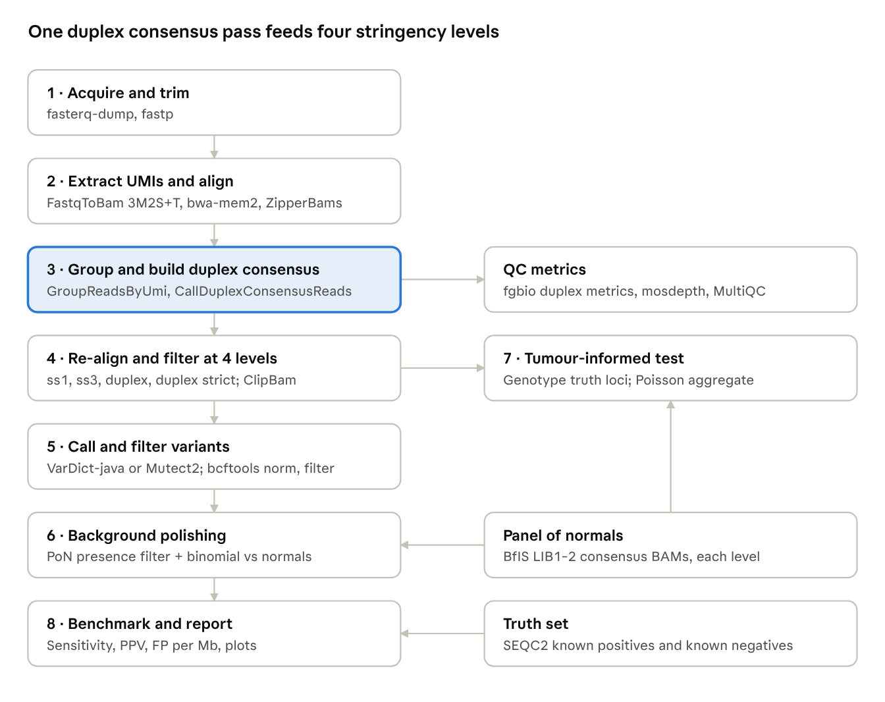

# xGen UMI duplex pipeline (Snakemake)

A Snakemake workflow for IDT xGen UMI duplex ctDNA sequencing, built and benchmarked on the SEQC2 ctDNA reference data (SRP296025, IDT assay). It takes UMI-tagged FASTQ through to duplex consensus BAMs, low-VAF calls and a stratified benchmark.

## Architecture



The highlighted step is the core of the workflow: one duplex consensus pass that every downstream family-size level, call set and benchmark is built from.

```
SRA (prefetch/fasterq-dump) or local FASTQ
  -> FastQC (raw QC)
  -> fastp            3'-only adapter/quality/poly-G trim (UMI at 5' untouched)
  -> fgbio FastqToBam read structure 3M2S+T 3M2S+T -> uBAM with RX=AAA-CCC
  -> samtools fastq | bwa-mem2 mem -p -K 150M -Y | fgbio ZipperBams | samtools sort --template-coordinate
  -> fgbio GroupReadsByUmi --strategy paired --edits 0        (+ family-size histogram)
       -> fgbio CollectDuplexSeqMetrics                       (family sizes, duplex yield curve)
  -> fgbio CallDuplexConsensusReads --min-reads 1 1 0         (one permissive pass)
  -> samtools fastq | bwa-mem2 mem | ZipperBams (consensus tags reversed/revcomp)
  -> for each family-size level:
       FilterConsensusReads -> ClipBam (overlap clip) [-> fragment-length filter] -> sort/index = consensus BAM
       -> samtools stats (fragment-length distribution)
       -> tumour-agnostic: VarDict (or Mutect2) -> bcftools norm + filter
            -> background polishing vs panel of normals (iDES)          = final VCF
            -> benchmark.py vs truth (sensitivity/PPV by VAF bin, FP/Mb, FP error spectrum)
       -> tumour-informed: pileup at truth loci -> informed_detect.py
            (per-locus detection, Signatera >=2-loci call, INVAR aggregate call)
  -> summarise.py (pooled tables + PNG figures) and MultiQC
```

## Two analysis strategies (tumour-agnostic vs tumour-informed)

The CRC MRD literature splits into two approaches, and the SEQC2 truth set lets this pipeline run both on the same consensus BAM:

- **Tumour-agnostic** (fixed panel, de novo calling): VarDict/Mutect2 on the consensus BAM, then filtering. This is what a plasma-only assay has to do. Its floor is set by the per-site error rate and the ALT-molecule threshold.
- **Tumour-informed** (`results/informed/`): the truth loci stand in for a patient's tumour-derived variant list. The consensus BAM is piled up at those sites, and detection is decided from the ALT molecule counts directly, with no caller in the way. Two sample-level rules are reported: Signatera-style (sample positive if ≥2 loci each carry ≥2 ALT molecules; Reinert et al. 2019) and INVAR-style (total ALT molecules across all loci tested against the summed per-locus background with a Poisson test; Wan et al. 2020). Informed mode is expected to stay sensitive one to two VAF bins below where de novo calling drops off, because it aggregates evidence across loci rather than needing each locus to clear a threshold.

**Background polishing (iDES, Newman et al. 2016).** UMI consensus removes random errors but not stereotyped ones (C>T from deamination, G>T from oxidative damage, mapping artefacts) that recur at the same positions in every sample. Mark pure-gDNA runs as `role=normal` in `samples.tsv`; each call is then tested against the pooled normal pileup at that site and allele (binomial, `alpha` 0.01, with a 5e-5 error floor so an unobserved error never has rate 0). Calls that are not above background get `FILTER=Background`. The benchmark also reports the substitution spectrum of the remaining false positives (`fp_spectrum`); if C>T and C>A dominate, polishing or oxidation repair is the next lever, not a stricter family-size threshold.

**Fragment length (INVAR).** ctDNA fragments are shorter than background cfDNA. `samtools stats` gives the insert-size distribution for every consensus BAM. `fragment.max_tlen` (off by default) keeps only templates up to that length; it increases the ctDNA fraction per molecule but discards molecules, so run it as a separate outdir and compare sensitivity at the lowest VAF bins.

## Design decisions (sensitivity vs specificity)

**UMI grouping: `paired`, `edits 0`.** Each read has only a 3 bp UMI (64 values). Allowing one mismatch makes 9 of the 63 other values neighbours, so distinct molecules at the same position merge and real low-VAF alleles get diluted. With 3 bp UMIs, mapping position is doing most of the work of telling molecules apart. Keep `edits 0` and look at the family-size histogram. If singletons are inflated by UMI sequencing errors, try `edits 1` as a sensitivity check.

**Consensus: `error-rate-pre-umi 45`, `post-umi 30`, `min-input-base-quality 20`.** These are the fgbio defaults for duplex libraries. Raising the input base quality from 10 to 20 stops Q2–Q19 bases from voting.

**Family-size levels** (`config.filter_levels`, given as `min_reads` = total / larger strand / smaller strand):

| level | min_reads | min_alt | expected behaviour |
|---|---|---|---|
| ss1 | 1 1 0 | 3 | most molecules, but singletons carry raw PCR/sequencing error, so the most FPs |
| ss3 | 3 3 0 | 2 | single-strand error correction; PCR errors in the first cycle survive |
| duplex | 2 1 1 | 2 | both strands must agree, so error ~1e-6 or lower, but only molecules with both strands recovered |
| duplex_strict | 6 3 3 | 1 | highest specificity; molecule count drops sharply, so sensitivity at ≤0.1% VAF collapses |

The expected picture: going from ss1 to duplex raises PPV and cuts FP/Mb a lot, while sensitivity at ≥1% VAF hardly moves. Below about 0.25% VAF, sensitivity is limited by molecule count rather than error rate. There, stricter levels lose more than they gain.

**Consensus filtering.** Bases below Q30 are masked to N. Reads are dropped if their error rate is above 2.5% or more than 20% of bases are no-calls.

**Calling.** The default is VarDict at `-f 0.0005`. It is fast on a panel and reports AF/AD directly. Mutect2 tumor-only is available with `caller: mutect2`. VarDict's `Bias` filter is removed because a consensus read already combines both strands. The final filter needs ALT support of at least `min_alt` consensus reads, DP ≥ 100 and AF ≥ 0.05%.

**Benchmark.**
- Calls and truth are both normalised with `bcftools norm -m-any` against the same reference, then restricted to the panel BED.
- Sensitivity is binned by **expected** VAF (truth VAF × `vaf_scale`). PPV is binned by **observed** VAF, because FPs have no truth VAF.
- If `negative_bed` (SEQC2 known-negative regions) is set, only calls inside it count as FP. Other non-truth calls are reported as `unclassified`. Without it, every non-truth call counts as FP, which is conservative.
- `vaf_scale` is the fraction of Sample A in the mix: Sample D (Lbx-high, 20% A) = 0.2, Sample E (Lbx-low, 4% A) = 0.04 (Deveson et al. 2021).

**Where sensitivity plateaus.** Read this off `duplex_yield.png`, the CollectDuplexSeqMetrics downsampling curve. Where duplex families stop growing as read pairs increase, the library is saturated and more sequencing adds nothing. Then compare the number of duplex molecules per locus (mosdepth on the `duplex` BAM) with 1/VAF. At 0.1% VAF you need about 3,000 or more duplex molecules to expect 3 ALT molecules. A plateau below that means input DNA/library complexity is the limit, not the caller.

**Aligner: bwa-mem2 2.3.** Same alignments as bwa mem 0.7.x, 1.3-3x faster; the only cost is a larger index that needs tens of GB RAM to build once. Faster forks (bwa-mem3, minibwa) give comparable rather than identical output, so they'd need their own validation and are left as a future speed-up.

## Running

```bash
# 1. build config/samples.tsv (needs internet for the run table)
curl -s "https://www.ebi.ac.uk/ena/portal/api/filereport?accession=SRP296025&result=read_run&fields=run_accession,experiment_alias,read_count,base_count&format=tsv&limit=0" \
  > resources/metadata/SRP296025_runs.tsv
python scripts/make_samples.py --runs resources/metadata/SRP296025_runs.tsv --fill config/samples.tsv   # fill SRRs for the default subset
# add --titration (EfIS 10/50 ng), --plasma (Ep), --site ST05|ST06|all as needed
#    default set: DfIS/EfIS/BfIS 25 ng libraries at one site
# 2. truth: Sample A known positives (hg38 VCF) + known negatives (BED, hg19 -> liftOver) from
#    figshare https://doi.org/10.6084/m9.figshare.13511829 (Jones et al. 2021, Genome Biol 22:111)
#    panel BED: IDT xGen NSCLC ctDNA targets, hg38 (figshare 19092086 or IDT)
#    check chr naming matches GCA_000001405.15 (chr1...), and liftOver anything hg19
snakemake -n --profile profiles/local          # dry run
snakemake --profile profiles/local
snakemake --profile profiles/local --config caller=mutect2 outdir=results_m2   # caller comparison
```

To skip the download, put local FASTQ paths in `fq1`/`fq2`.

Outputs, restarting from existing BAMs, helper scripts and references: see [`.README-notes.md`](.README-notes.md).
